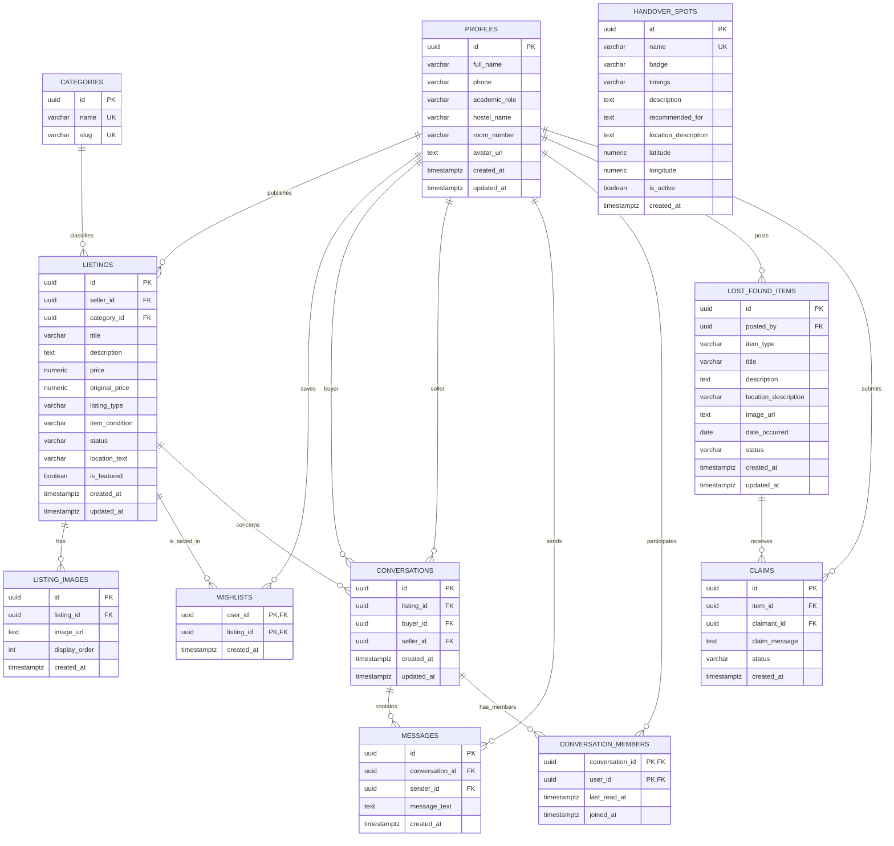

# CP2 ER Diagram — Final Price? Student Marketplace

## Relationship notes

- A profile can publish many listings; each listing has one seller and one category.
- A listing can have multiple images and can be saved by many profiles through `wishlists`.
- A listing can have buyer/seller conversations; each conversation contains messages.
- `conversation_members` records each participant and their read state.
- A profile can post lost-and-found reports; each report can receive claims.
- Handover spots are independent campus locations.
- `wishlists` and `conversation_members` use composite primary keys.
- `categories`, `conversations`, `claims`, and `handover_spots` include alternate unique keys documented in CP1.
