# CP2: Hostel OLX? — Campus Marketplace Entity-Relationship (ER) Specification

## 1. Executive Architectural Overview

**Hostel OLX?** is an end-to-end, local-first campus marketplace engineered for **Rishihood University**. The database architecture is designed for **PostgreSQL 15+** and strictly satisfies **Boyce-Codd Normal Form (BCNF)** across **14 core relations**.

The schema is divided into 5 modular subsystems:
1. **Campus Identity & Trust**: Manages university-verified student profiles (`users`), academic credentials, hostel residencies, and dynamic reputation scores.
2. **Item Catalog & Taxonomy**: Handles product categories (`categories`), rich marketplace items (`listings`), photo galleries (`listing_images`), and saved bookmarks (`saved_listings`).
3. **OLX Bargaining & Physical Handover**: Powers direct peer-to-peer price negotiations (`price_offers`), scheduled safe physical exchanges (`handover_transactions`), and post-handover peer evaluations (`peer_reviews`).
4. **Real-Time Campus Messaging**: Organizes item-anchored negotiation threads (`chat_channels`) and chronological chat messages (`chat_messages`).
5. **Campus Care & Governance**: Operates a campus lost-and-found hub (`lost_found_reports`, `claim_requests`), verified meeting points (`handover_spots`), and incident moderation (`safety_reports`).

---

## 2. Complete Mermaid ER Diagram

```mermaid
erDiagram
    USERS {
        uuid id PK
        varchar email UK "rishihood.edu.in"
        varchar roll_number UK
        varchar full_name
        varchar phone_number
        varchar hostel_block
        varchar room_number
        varchar program_of_study
        smallint graduation_year
        text avatar_url
        boolean is_verified_student
        numeric reputation_score "0.00 to 5.00"
        timestamptz created_at
        timestamptz updated_at
    }

    CATEGORIES {
        uuid id PK
        varchar name UK
        varchar slug UK
        varchar icon_name
        varchar description
        int display_order
        boolean is_active
        timestamptz created_at
    }

    HANDOVER_SPOTS {
        uuid id PK
        varchar spot_name UK
        varchar zone_code
        text landmark_description
        varchar security_level
        varchar available_hours
        numeric latitude
        numeric longitude
        boolean is_active
        timestamptz created_at
    }

    LISTINGS {
        uuid id PK
        uuid seller_id FK
        uuid category_id FK
        uuid preferred_spot_id FK
        varchar title
        text description
        numeric price ">= 0"
        numeric original_purchase_price
        boolean is_negotiable
        varchar listing_type "sale, giveaway, exchange, urgent"
        varchar item_condition "brand_new, like_new, good, fair, repair"
        varchar status "active, under_offer, reserved, sold, archived"
        int view_count
        timestamptz created_at
        timestamptz updated_at
    }

    LISTING_IMAGES {
        uuid id PK
        uuid listing_id FK
        text image_url
        boolean is_cover
        int display_order
        timestamptz created_at
    }

    SAVED_LISTINGS {
        uuid user_id PK, FK
        uuid listing_id PK, FK
        varchar personal_note
        timestamptz created_at
    }

    PRICE_OFFERS {
        uuid id PK
        uuid listing_id FK
        uuid buyer_id FK
        numeric offered_amount "> 0"
        numeric counter_amount
        varchar buyer_note
        varchar status "pending, accepted, countered, declined, expired"
        timestamptz expires_at
        timestamptz created_at
        timestamptz updated_at
    }

    HANDOVER_TRANSACTIONS {
        uuid id PK
        uuid listing_id FK
        uuid buyer_id FK
        uuid seller_id FK
        uuid accepted_offer_id FK
        uuid spot_id FK
        numeric final_agreed_price
        varchar payment_method "upi_on_spot, cash, giveaway"
        varchar verification_pin "6-char OTP"
        timestamptz scheduled_time
        varchar status "scheduled, arrived, completed, cancelled"
        timestamptz completed_at
        timestamptz created_at
        timestamptz updated_at
    }

    PEER_REVIEWS {
        uuid id PK
        uuid transaction_id FK, UK
        uuid reviewer_id FK
        uuid reviewee_id FK
        smallint rating_stars "1 to 5"
        text review_comment
        smallint punctuality_rating "1 to 5"
        smallint item_accuracy_rating "1 to 5"
        timestamptz created_at
    }

    CHAT_CHANNELS {
        uuid id PK
        uuid listing_id FK
        uuid buyer_id FK
        uuid seller_id FK
        boolean is_active
        timestamptz last_message_at
        timestamptz created_at
    }

    CHAT_MESSAGES {
        uuid id PK
        uuid channel_id FK
        uuid sender_id FK
        text message_body
        varchar message_type "text, image, offer, location, system"
        boolean is_read
        timestamptz sent_at
    }

    LOST_FOUND_REPORTS {
        uuid id PK
        uuid reporter_id FK
        uuid category_id FK
        varchar report_type "lost, found"
        varchar item_name
        text description
        varchar last_seen_location
        date event_date
        text image_url
        varchar custody_location
        varchar status "open, claim_pending, resolved, closed"
        timestamptz created_at
        timestamptz updated_at
    }

    CLAIM_REQUESTS {
        uuid id PK
        uuid report_id FK
        uuid claimant_id FK
        text proof_description
        text identifying_features
        varchar contact_phone
        varchar status "pending, under_verification, approved, rejected"
        text resolution_remarks
        timestamptz created_at
        timestamptz updated_at
    }

    SAFETY_REPORTS {
        uuid id PK
        uuid reporter_id FK
        uuid reported_user_id FK
        uuid reported_listing_id FK
        varchar violation_category "counterfeit, harassment, scam, prohibited"
        text report_details
        varchar status "pending, investigating, resolved, dismissed"
        text admin_notes
        timestamptz created_at
        timestamptz resolved_at
    }

    %% Relationships & Cardinalities
    USERS ||--o{ LISTINGS : "publishes (seller)"
    CATEGORIES ||--o{ LISTINGS : "classifies"
    HANDOVER_SPOTS ||--o{ LISTINGS : "preferred_pickup"
    LISTINGS ||--o{ LISTING_IMAGES : "has_photos"
    USERS ||--o{ SAVED_LISTINGS : "bookmarks"
    LISTINGS ||--o{ SAVED_LISTINGS : "is_saved_in"
    LISTINGS ||--o{ PRICE_OFFERS : "receives_offers"
    USERS ||--o{ PRICE_OFFERS : "submits_offer (buyer)"
    LISTINGS ||--o{ HANDOVER_TRANSACTIONS : "orders"
    USERS ||--o{ HANDOVER_TRANSACTIONS : "buys_in"
    USERS ||--o{ HANDOVER_TRANSACTIONS : "sells_in"
    HANDOVER_SPOTS ||--o{ HANDOVER_TRANSACTIONS : "designated_spot"
    PRICE_OFFERS ||--o| HANDOVER_TRANSACTIONS : "formalizes_offer"
    HANDOVER_TRANSACTIONS ||--o| PEER_REVIEWS : "evaluated_by"
    USERS ||--o{ PEER_REVIEWS : "submits_review"
    USERS ||--o{ PEER_REVIEWS : "receives_review"
    LISTINGS ||--o{ CHAT_CHANNELS : "discusses"
    USERS ||--o{ CHAT_CHANNELS : "participates_as_buyer"
    USERS ||--o{ CHAT_CHANNELS : "participates_as_seller"
    CHAT_CHANNELS ||--o{ CHAT_MESSAGES : "contains"
    USERS ||--o{ CHAT_MESSAGES : "posts"
    USERS ||--o{ LOST_FOUND_REPORTS : "files_report"
    CATEGORIES ||--o{ LOST_FOUND_REPORTS : "categorizes_item"
    LOST_FOUND_REPORTS ||--o{ CLAIM_REQUESTS : "receives_claims"
    USERS ||--o{ CLAIM_REQUESTS : "claims_item"
    USERS ||--o{ SAFETY_REPORTS : "submits_report"
    USERS ||--o{ SAFETY_REPORTS : "targeted_in"
    LISTINGS ||--o{ SAFETY_REPORTS : "flagged_in"
```

---

## 3. Comprehensive Data Dictionary

### 3.1 `users`
Represents verified Rishihood University students participating in the marketplace.

| Attribute | Data Type | Constraints | Description |
|---|---|---|---|
| `id` | `UUID` | `PRIMARY KEY`, Default `gen_random_uuid()` | Unique immutable student identifier. |
| `email` | `VARCHAR(150)` | `NOT NULL`, `UNIQUE`, `CHECK (~* '@.*rishihood.edu.in')` | Verified university student email. |
| `roll_number` | `VARCHAR(30)` | `UNIQUE` | Official campus roll/registration number. |
| `full_name` | `VARCHAR(120)` | `NOT NULL` | Student's full display name. |
| `phone_number` | `VARCHAR(20)` | Optional | Contact phone number for pickup coordination. |
| `hostel_block` | `VARCHAR(50)` | `NOT NULL` | Hostel residency block (e.g., "Hostel A", "Tower 2"). |
| `room_number` | `VARCHAR(20)` | `NOT NULL` | Hostel room number. |
| `program_of_study` | `VARCHAR(80)` | Optional | Degree program (e.g., "B.Tech CS", "B.Des"). |
| `graduation_year` | `SMALLINT` | `CHECK (>= 2024)` | Expected graduation year. |
| `avatar_url` | `TEXT` | Optional | Profile image CDN link. |
| `is_verified_student` | `BOOLEAN` | `NOT NULL`, Default `TRUE` | Academic email verification status. |
| `reputation_score` | `NUMERIC(3,2)` | `NOT NULL`, Default `5.00`, `CHECK (0.00..5.00)` | Aggregate peer trust rating. |
| `created_at` | `TIMESTAMPTZ` | `NOT NULL`, Default `CURRENT_TIMESTAMP` | Account creation timestamp. |
| `updated_at` | `TIMESTAMPTZ` | `NOT NULL`, Default `CURRENT_TIMESTAMP` | Last profile update timestamp (managed via trigger). |

---

### 3.2 `categories`
Marketplace taxonomy organizing products into structured campus categories.

| Attribute | Data Type | Constraints | Description |
|---|---|---|---|
| `id` | `UUID` | `PRIMARY KEY`, Default `gen_random_uuid()` | Unique category identifier. |
| `name` | `VARCHAR(80)` | `NOT NULL`, `UNIQUE` | Display name (e.g., "Dorm Furniture", "Textbooks"). |
| `slug` | `VARCHAR(80)` | `NOT NULL`, `UNIQUE` | URL-friendly slug (e.g., "dorm-furniture"). |
| `icon_name` | `VARCHAR(50)` | Optional | UI icon identifier (e.g., "book-open", "armchair"). |
| `description` | `VARCHAR(255)` | Optional | Category scope description. |
| `display_order` | `INTEGER` | `NOT NULL`, Default `0` | Order of appearance on homepage navigation. |
| `is_active` | `BOOLEAN` | `NOT NULL`, Default `TRUE` | Category visibility toggle. |
| `created_at` | `TIMESTAMPTZ` | `NOT NULL`, Default `CURRENT_TIMESTAMP` | Creation timestamp. |

---

### 3.3 `handover_spots`
Designated campus safe zones recommended for physical item inspection and transactions.

| Attribute | Data Type | Constraints | Description |
|---|---|---|---|
| `id` | `UUID` | `PRIMARY KEY`, Default `gen_random_uuid()` | Unique spot identifier. |
| `spot_name` | `VARCHAR(120)` | `NOT NULL`, `UNIQUE` | Recognizable campus landmark name. |
| `zone_code` | `VARCHAR(40)` | `NOT NULL` | Zone grouping (e.g., "HOSTEL_NORTH", "CENTRAL_MESS"). |
| `landmark_description` | `TEXT` | `NOT NULL` | Physical directions and meeting point cues. |
| `security_level` | `VARCHAR(30)` | `NOT NULL`, `CHECK ('cctv_monitored', 'guard_station', 'high_footfall', 'standard')` | Safety classification. |
| `available_hours` | `VARCHAR(80)` | `NOT NULL`, Default `'08:00 AM - 10:00 PM'` | Recommended meeting hours. |
| `latitude` | `NUMERIC(9,6)` | `CHECK (-90.000000..90.000000)` | GPS latitude coordinate. |
| `longitude` | `NUMERIC(9,6)` | `CHECK (-180.000000..180.000000)` | GPS longitude coordinate. |
| `is_active` | `BOOLEAN` | `NOT NULL`, Default `TRUE` | Operational availability flag. |
| `created_at` | `TIMESTAMPTZ` | `NOT NULL`, Default `CURRENT_TIMESTAMP` | Creation timestamp. |

---

### 3.4 `listings`
Core marketplace items listed for sale, barter, or donation.

| Attribute | Data Type | Constraints | Description |
|---|---|---|---|
| `id` | `UUID` | `PRIMARY KEY`, Default `gen_random_uuid()` | Unique listing identifier. |
| `seller_id` | `UUID` | `NOT NULL`, `FK -> users(id)`, `ON DELETE RESTRICT` | Student offering the item. |
| `category_id` | `UUID` | `NOT NULL`, `FK -> categories(id)`, `ON DELETE RESTRICT` | Category classification. |
| `preferred_spot_id` | `UUID` | `FK -> handover_spots(id)`, `ON DELETE SET NULL` | Seller's preferred on-campus exchange location. |
| `title` | `VARCHAR(180)` | `NOT NULL` | Concise title of the item. |
| `description` | `TEXT` | `NOT NULL` | Full item details, history, and usage state. |
| `price` | `NUMERIC(10,2)` | `NOT NULL`, Default `0.00`, `CHECK (price >= 0)` | Asking price in INR. |
| `original_purchase_price` | `NUMERIC(10,2)` | Optional, `CHECK (original_price >= price)` | Original retail price for discount comparison. |
| `is_negotiable` | `BOOLEAN` | `NOT NULL`, Default `TRUE` | Whether buyer can submit lower offers. |
| `listing_type` | `VARCHAR(20)` | `NOT NULL`, `CHECK ('sale', 'giveaway', 'exchange', 'urgent_sale')` | Commercial transaction model. |
| `item_condition` | `VARCHAR(25)` | `NOT NULL`, `CHECK ('brand_new', 'like_new', 'good', 'fair', 'needs_repair')` | Physical condition rating. |
| `status` | `VARCHAR(20)` | `NOT NULL`, `CHECK ('active', 'under_offer', 'reserved', 'sold', 'archived', 'delisted')` | Lifecycle state of listing. |
| `view_count` | `INTEGER` | `NOT NULL`, Default `0`, `CHECK (>= 0)` | Popularity metric. |
| `created_at` | `TIMESTAMPTZ` | `NOT NULL`, Default `CURRENT_TIMESTAMP` | Publishing timestamp. |
| `updated_at` | `TIMESTAMPTZ` | `NOT NULL`, Default `CURRENT_TIMESTAMP` | Last updated timestamp (trigger-managed). |

---

### 3.5 `listing_images`
Multiple high-resolution photos for each listing.

| Attribute | Data Type | Constraints | Description |
|---|---|---|---|
| `id` | `UUID` | `PRIMARY KEY`, Default `gen_random_uuid()` | Image record ID. |
| `listing_id` | `UUID` | `NOT NULL`, `FK -> listings(id)`, `ON DELETE CASCADE` | Associated listing. |
| `image_url` | `TEXT` | `NOT NULL` | Storage URL. |
| `is_cover` | `BOOLEAN` | `NOT NULL`, Default `FALSE` | Cover photo flag for thumbnail cards. |
| `display_order` | `INTEGER` | `NOT NULL`, Default `0`, `CHECK (>= 0)` | Carousel sorting order. |
| `created_at` | `TIMESTAMPTZ` | `NOT NULL`, Default `CURRENT_TIMESTAMP` | Upload timestamp. |

---

### 3.6 `saved_listings` (Wishlist Junction)
Many-to-many relationship tracking items saved by students.

| Attribute | Data Type | Constraints | Description |
|---|---|---|---|
| `user_id` | `UUID` | `PRIMARY KEY (composite)`, `FK -> users(id)`, `ON DELETE CASCADE` | Student saving the item. |
| `listing_id` | `UUID` | `PRIMARY KEY (composite)`, `FK -> listings(id)`, `ON DELETE CASCADE` | Saved listing. |
| `personal_note` | `VARCHAR(255)` | Optional | Student's private note or reminder. |
| `created_at` | `TIMESTAMPTZ` | `NOT NULL`, Default `CURRENT_TIMESTAMP` | Saved timestamp. |

---

### 3.7 `price_offers` (OLX Bargaining Engine)
Peer-to-peer price negotiation and counter-offer tracking.

| Attribute | Data Type | Constraints | Description |
|---|---|---|---|
| `id` | `UUID` | `PRIMARY KEY`, Default `gen_random_uuid()` | Offer ID. |
| `listing_id` | `UUID` | `NOT NULL`, `FK -> listings(id)`, `ON DELETE CASCADE` | Target listing. |
| `buyer_id` | `UUID` | `NOT NULL`, `FK -> users(id)`, `ON DELETE CASCADE` | Inquiring buyer. |
| `offered_amount` | `NUMERIC(10,2)` | `NOT NULL`, `CHECK (offered_amount > 0)` | Proposed price. |
| `counter_amount` | `NUMERIC(10,2)` | Optional, `CHECK (counter_amount > 0)` | Seller's counter proposal. |
| `buyer_note` | `VARCHAR(255)` | Optional | Short negotiation message. |
| `status` | `VARCHAR(20)` | `NOT NULL`, `CHECK ('pending', 'accepted', 'countered', 'declined', 'withdrawn', 'expired')` | Offer negotiation state. |
| `expires_at` | `TIMESTAMPTZ` | `NOT NULL` | Auto-expiration cutoff. |
| `created_at` | `TIMESTAMPTZ` | `NOT NULL`, Default `CURRENT_TIMESTAMP` | Offer creation time. |
| `updated_at` | `TIMESTAMPTZ` | `NOT NULL`, Default `CURRENT_TIMESTAMP` | Last status modification time. |

---

### 3.8 `handover_transactions`
Scheduled campus meetups, physical verification, and order closure.

| Attribute | Data Type | Constraints | Description |
|---|---|---|---|
| `id` | `UUID` | `PRIMARY KEY`, Default `gen_random_uuid()` | Order/transaction identifier. |
| `listing_id` | `UUID` | `NOT NULL`, `FK -> listings(id)`, `ON DELETE RESTRICT` | Purchased item. |
| `buyer_id` | `UUID` | `NOT NULL`, `FK -> users(id)`, `ON DELETE RESTRICT` | Buyer student. |
| `seller_id` | `UUID` | `NOT NULL`, `FK -> users(id)`, `ON DELETE RESTRICT` | Seller student. |
| `accepted_offer_id` | `UUID` | `FK -> price_offers(id)`, `ON DELETE SET NULL` | Linked agreed offer (if negotiated). |
| `spot_id` | `UUID` | `NOT NULL`, `FK -> handover_spots(id)`, `ON DELETE RESTRICT` | Agreed physical meeting location. |
| `final_agreed_price` | `NUMERIC(10,2)` | `NOT NULL`, `CHECK (final_agreed_price >= 0)` | Settled price in INR. |
| `payment_method` | `VARCHAR(25)` | `NOT NULL`, `CHECK ('upi_on_spot', 'cash_in_hand', 'free_giveaway')` | Physical payment mechanism. |
| `verification_pin` | `VARCHAR(6)` | `NOT NULL` | 6-character exchange confirmation code. |
| `scheduled_time` | `TIMESTAMPTZ` | `NOT NULL` | Agreed meeting timestamp. |
| `status` | `VARCHAR(20)` | `NOT NULL`, `CHECK ('scheduled', 'arrived', 'completed', 'cancelled', 'disputed')` | Transaction lifecycle status. |
| `completed_at` | `TIMESTAMPTZ` | Optional, `CHECK (completed_at >= created_at)` | Successful handover completion time. |
| `created_at` | `TIMESTAMPTZ` | `NOT NULL`, Default `CURRENT_TIMESTAMP` | Order scheduling time. |
| `updated_at` | `TIMESTAMPTZ` | `NOT NULL`, Default `CURRENT_TIMESTAMP` | Status change time. |

---

### 3.9 `peer_reviews`
Two-sided peer accountability and reputation ratings.

| Attribute | Data Type | Constraints | Description |
|---|---|---|---|
| `id` | `UUID` | `PRIMARY KEY`, Default `gen_random_uuid()` | Review identifier. |
| `transaction_id` | `UUID` | `NOT NULL`, `FK -> handover_transactions(id)`, `ON DELETE CASCADE` | Associated completed transaction. |
| `reviewer_id` | `UUID` | `NOT NULL`, `FK -> users(id)`, `ON DELETE RESTRICT` | Student submitting feedback. |
| `reviewee_id` | `UUID` | `NOT NULL`, `FK -> users(id)`, `ON DELETE RESTRICT` | Student being evaluated. |
| `rating_stars` | `SMALLINT` | `NOT NULL`, `CHECK (1 BETWEEN 5)` | Overall satisfaction score (1 to 5). |
| `review_comment` | `TEXT` | Optional | Descriptive testimonial. |
| `punctuality_rating` | `SMALLINT` | Optional, `CHECK (1 BETWEEN 5)` | Punctuality at handover spot. |
| `item_accuracy_rating` | `SMALLINT` | Optional, `CHECK (1 BETWEEN 5)` | Accuracy of listing condition. |
| `created_at` | `TIMESTAMPTZ` | `NOT NULL`, Default `CURRENT_TIMESTAMP` | Review posting timestamp. |

---

### 3.10 `chat_channels` & 3.11 `chat_messages`
Real-time negotiation and direct messaging.

- **`chat_channels`**: Encapsulates 1:1 conversation between `buyer_id` and `seller_id` on a specific `listing_id`. Unique composite constraint `(listing_id, buyer_id, seller_id)` prevents thread duplication.
- **`chat_messages`**: Stores chronological messages with polymorphic message types (`'text'`, `'image_url'`, `'offer_event'`, `'location_share'`, `'system_event'`) and unread tracking (`is_read`).

---

### 3.12 `lost_found_reports` & 3.13 `claim_requests`
Campus lost-and-found hub and claim validation workflow.

- **`lost_found_reports`**: Logs lost or found items with location, incident date, category, and custody depot.
- **`claim_requests`**: Enables students to submit proof of ownership, unique marks, and contact phone numbers. Enforces `UNIQUE(report_id, claimant_id)` to prevent duplicate active claims by the same claimant.

---

### 3.14 `safety_reports`
Governance and anti-scam campus moderation.

- Flags rule violations (`'counterfeit'`, `'harassment'`, `'scam_pricing'`, `'prohibited_goods'`, `'no_show_flake'`).
- Enforces `CHECK (reported_user_id IS NOT NULL OR reported_listing_id IS NOT NULL)` so every report has an identifiable target.

---

## 4. Referential Actions & Integrity Guarantees

| Parent Table | Child Table | Foreign Key | On Delete Action | Business Justification |
|---|---|---|---|---|
| `users` | `listings` | `seller_id` | `RESTRICT` | Prevents deleting an account with active or past listings. |
| `categories` | `listings` | `category_id` | `RESTRICT` | Protects catalog taxonomy integrity. |
| `handover_spots` | `listings` | `preferred_spot_id` | `SET NULL` | If a spot is archived, listing remains valid without preferred spot. |
| `listings` | `listing_images` | `listing_id` | `CASCADE` | Removing a listing automatically cleans up all associated media. |
| `users` / `listings` | `saved_listings` | `user_id` / `listing_id` | `CASCADE` | Deleting either user or item removes wishlist bookmarks. |
| `listings` / `users` | `price_offers` | `listing_id` / `buyer_id` | `CASCADE` | Deleting item removes all open offers. |
| `users` / `listings` | `handover_transactions`| `buyer_id`, `seller_id`, `listing_id` | `RESTRICT` | Auditable financial/transaction records must never disappear. |
| `handover_transactions` | `peer_reviews` | `transaction_id` | `CASCADE` | Review belongs strictly to the transaction. |
| `chat_channels` | `chat_messages` | `channel_id` | `CASCADE` | Thread deletion cascades to message archive. |
| `lost_found_reports` | `claim_requests` | `report_id` | `CASCADE` | Closing/deleting incident report cleans up claims. |
